# Tootsie - Mastodon Client for Android
[](https://github.com/pfitzer/Tootsie/actions/workflows/tests.yml)
[](https://github.com/pfitzer/Tootsie/actions/workflows/build-apk.yml)

Tootsie is a modern, high-performance, and privacy-respecting Mastodon client for Android. Built from the ground up with Jetpack Compose and Kotlin, it follows Clean Architecture principles to provide a smooth experience for the Fediverse.

## 📱 Screenshots

<p align="center">
  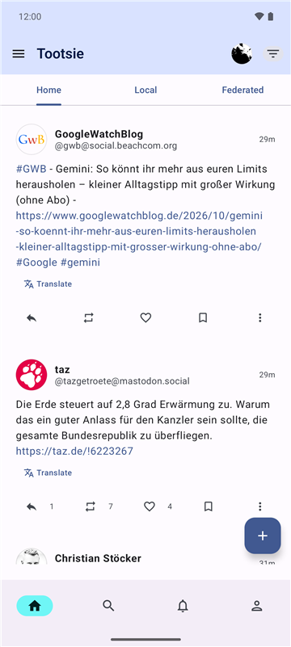
  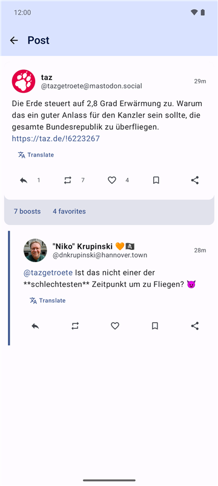
  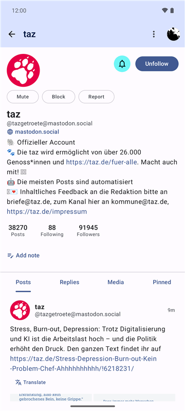
  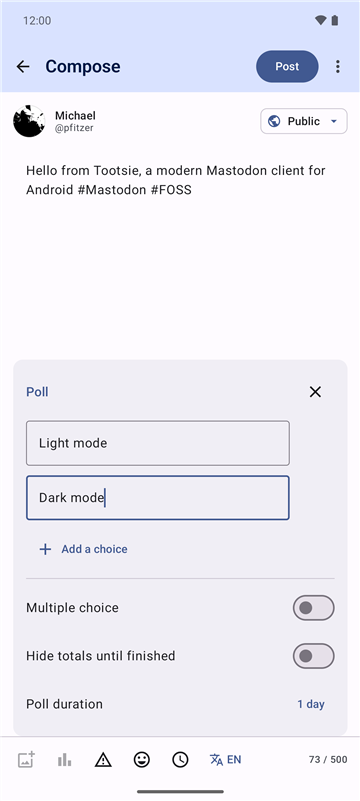
  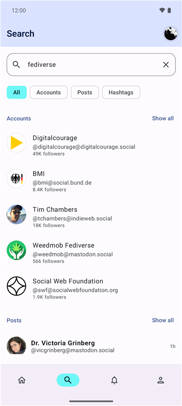
  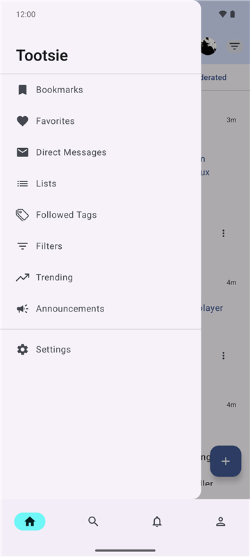
  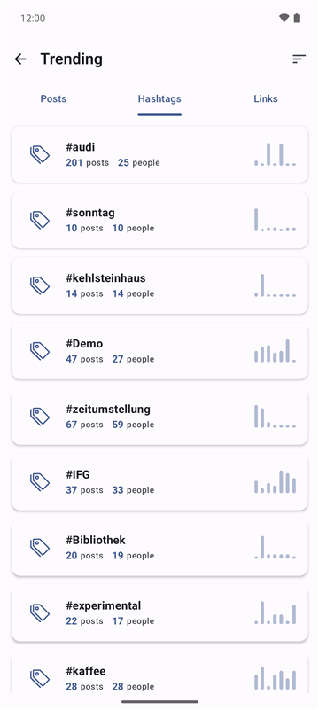
  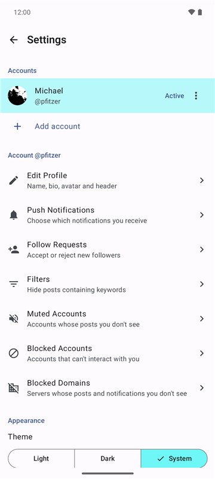
</p>

<details>
<summary>Dark mode</summary>

<p align="center">
  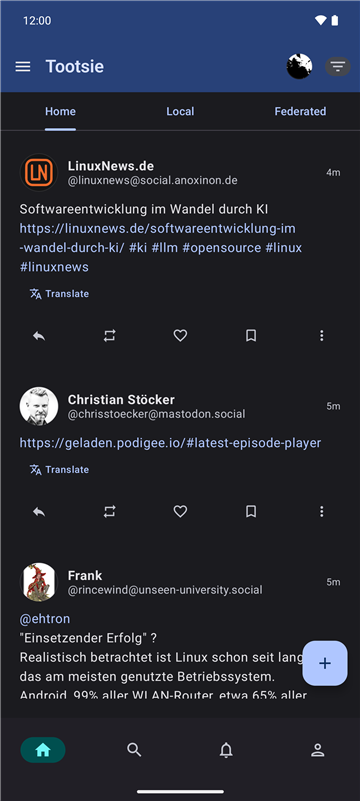
  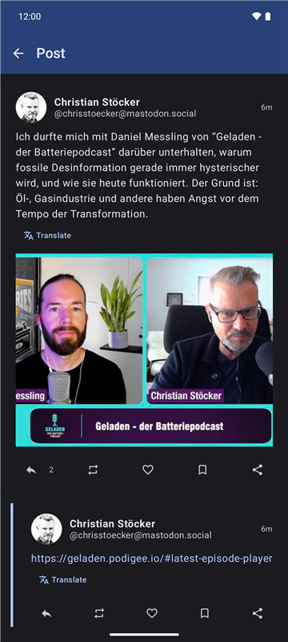
  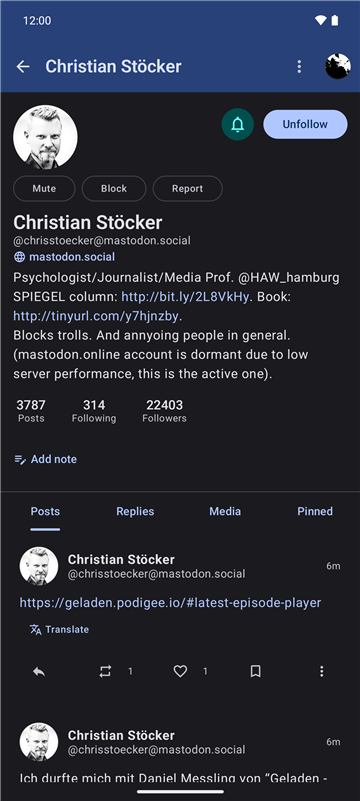
  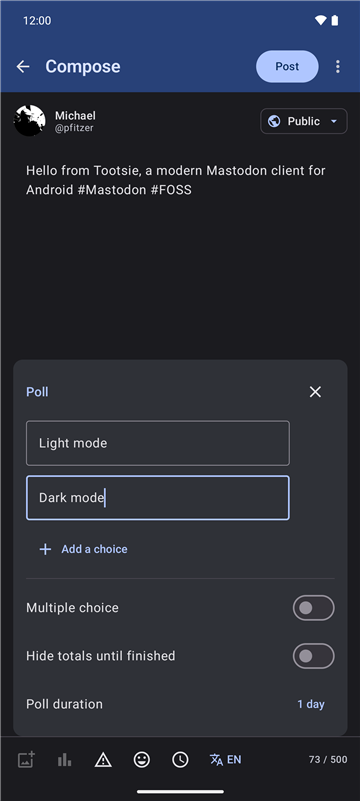
  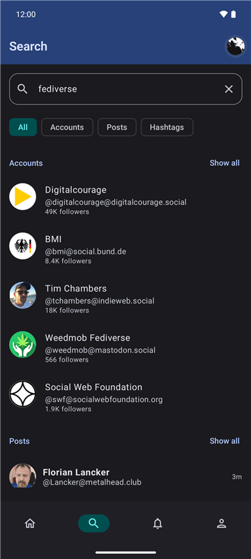
  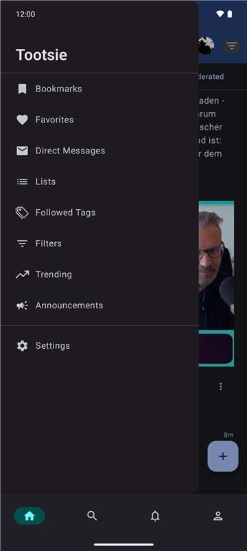
  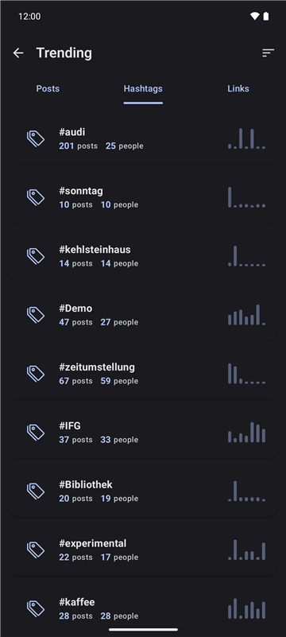
  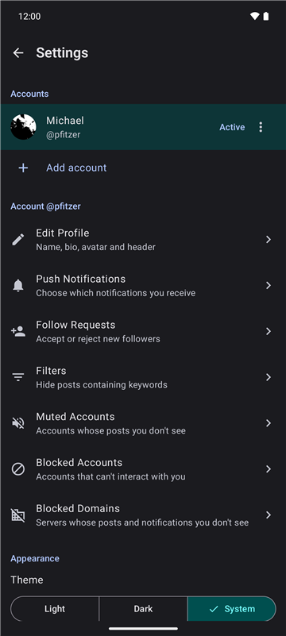
</p>

</details>

## 🚀 Features

- **Multi-Account Support**: Seamlessly switch between multiple Mastodon accounts without app reloads.
- **Modern UI**: Fully built with Jetpack Compose and Material Design 3, with adjustable text size.
- **Offline-First Timelines**: Home, local and federated timelines are loaded into a Room database (Paging `RemoteMediator`) and stay fully scrollable without a network connection.
- **Privacy First**:
    - **UnifiedPush** notifications, no Firebase/FCM required. Payloads are decrypted on the device (RFC 8291 Web Push encryption); a WorkManager polling fallback covers all accounts when no distributor is available.
    - Access tokens are encrypted at rest with a non-exportable Android Keystore key (AES-GCM), in DataStore and in the Room database.
- **Posts & Threads**:
    - Favourite, boost, bookmark and reply; the state updates immediately in every list.
    - **Edit own posts** (text, content warning, media and alt texts, poll), see the **edit history** of edited posts, **delete** or **delete & redraft**.
    - See who **favourited and boosted** a post.
    - **Translate** posts in other languages through the server's translation service, or hand them to a translator app.
    - **Quote posts**: boost or quote a post, with the author's quote policy respected (Mastodon 4.5+).
    - **Content warnings** hide text, media and polls until expanded; sensitive media is blurred.
    - Threads automatically load **missing replies from other servers** (Mastodon 4.5+).
    - Polls (view, vote, create), custom emoji picker, draft auto-save and management (media, poll and language included); mark media as sensitive.
- **Rich Media**: Images, videos and audio (ExoPlayer); uncached remote media is loaded through the instance's media proxy.
- **Filters**:
    - Timeline filters (hide boosts, replies, or show only media).
    - **Keyword filters** to hide or warn about posts, matched against the visible text of a post.
- **Organization**: Lists (create, edit, manage members), followed hashtags, bookmarks, favourites, drafts.
- **Discovery**: Search for accounts, posts and hashtags; trending hashtags, posts and links; announcements.
- **Profiles**: Followers and following lists, notifications for new posts of an account, private notes, the server of remote accounts.
- **Account Management**: Profile editing, follow requests, muted and blocked accounts, blocked domains.
- **Scheduled Posts**: Pick a publication time when composing; reschedule, edit or delete scheduled posts.
- **Reading position**: The home timeline position and read notifications are synced with Mastodon's markers, shared with the web interface and other apps.
- **Accessible**: TalkBack actions on every post, counts read with their buttons, alt texts and fallbacks for media.
- **Internationalized**: English and German.

Some features depend on the server version: quote posts and fetching remote replies need Mastodon 4.5 or newer, decrypting push notifications needs Mastodon 4.4 or newer. On older servers Tootsie falls back to the previous behaviour (e.g. the boost button boosts directly).

## 🛠 Tech Stack

- **Language**: [Kotlin](https://kotlinlang.org/) 2.4
- **Build**: Gradle 9.7, Android Gradle Plugin 9.4, version catalog (`gradle/libs.versions.toml`)
- **UI Framework**: [Jetpack Compose](https://developer.android.com/compose) with Material Design 3
- **Architecture**: Clean Architecture (Presentation, Domain, Data) + MVVM + MVI
- **Dependency Injection**: [Hilt](https://developer.android.com/training/dependency-injection/hilt-android)
- **Local Database**: [Room](https://developer.android.com/training/data-storage/room) with exported schemas and migration tests
- **Preferences**: [DataStore](https://developer.android.com/topic/libraries/architecture/datastore)
- **Networking**: [Retrofit](https://square.github.io/retrofit/) + [OkHttp](https://square.github.io/okhttp/)
- **Serialization**: [Kotlinx Serialization](https://github.com/Kotlin/kotlinx.serialization)
- **Push Notifications**: [UnifiedPush](https://unifiedpush.org/)
- **Image Loading**: [Coil](https://coil-kt.github.io/coil/)
- **Paging**: [Paging 3](https://developer.android.com/topic/libraries/architecture/paging/v3-overview)
- **Background Tasks**: [WorkManager](https://developer.android.com/topic/libraries/architecture/workmanager)
- **Testing**: JUnit, MockK, kotlinx-coroutines-test, Compose UI tests, Room `MigrationTestHelper`

## 📋 Requirements

- A recent Android Studio that supports Android Gradle Plugin 9.4
- JDK 21 to run Gradle (the app itself compiles to Java 11 bytecode)
- Android SDK 37
- Android device/emulator running Android 12 (API 31) or higher

## ⚙️ Setup & Installation

1. **Clone the repository**:
   ```bash
   git clone https://github.com/pfitzer/tootsie.git
   cd tootsie
   ```

2. **Open in Android Studio**:
   Import the project and let Gradle sync.

3. **Build & Run**:
   Select the `app` configuration and run it on your device or emulator.

### Build Commands (Gradle)
- **Assemble Debug APK**: `./gradlew assembleDebug`
- **Assemble Release APK**: `./gradlew assembleRelease`
- **Run Unit Tests**: `./gradlew testDebugUnitTest`
- **Run Instrumented Tests** (needs a connected device or emulator): `./gradlew connectedDebugAndroidTest`
- **Run only the Room migration tests**:
  ```bash
  ./gradlew :app:connectedDebugAndroidTest -Pandroid.testInstrumentationRunnerArguments.class=com.pfitzer.tootsie.data.local.TootsieDatabaseMigrationTest
  ```

Instrumented test runs uninstall the app afterwards, which deletes its data (including logins). Add `-Pandroid.injected.androidTest.leaveApksInstalledAfterRun=true` to keep it installed.

CI (GitHub Actions) runs the unit tests and builds debug and release APKs; instrumented tests are not part of CI.

## 📂 Project Structure

```
app/
├── schemas/                   # Exported Room schemas (one JSON per database version)
└── src/main/java/com/pfitzer/tootsie/
    ├── TootsieApplication.kt  # Hilt application, UnifiedPush callbacks
    ├── MainActivity.kt        # Single activity hosting Compose
    ├── di/                    # Dependency injection modules
    ├── data/                  # Data layer
    │   ├── local/             # Room (DAOs, entities, database), DataStore, credential encryption
    │   ├── remote/            # Retrofit API, DTOs, interceptors, account-scoped credentials
    │   ├── repository/        # Repository implementations
    │   ├── mapper/            # DTO / entity ↔ domain mappers
    │   └── paging/            # Paging sources, keyword filter matching
    ├── domain/                # Domain layer (pure Kotlin)
    │   ├── model/             # Domain models
    │   ├── repository/        # Repository interfaces
    │   └── usecase/           # Use cases
    ├── presentation/          # Presentation layer
    │   ├── screens/           # Screen composables & ViewModels
    │   ├── components/        # Reusable UI components
    │   ├── navigation/        # Navigation graph and destinations
    │   ├── theme/             # Material 3 theme
    │   └── util/              # UI helpers (HTML rendering, UiText, …)
    ├── push/                  # UnifiedPush service, Web Push decryption, notifications
    ├── worker/                # WorkManager workers (notification polling)
    └── util/                  # Cross-cutting utilities
```

## ⚠️ Critical Development Guidelines

When contributing to Tootsie, please adhere to these architectural guardrails (details in [CLAUDE.md](CLAUDE.md)):

1. **DataStore Reads**: Never use `.collect {}` on `DataStore.data` for one-time reads as it is a hot flow and will block infinitely. Always use `.first()`.
2. **OkHttp Interceptors**: Never use `runBlocking` or suspend functions inside interceptors. Use the **Provider Pattern** with `AtomicReference` for thread-safe, synchronous access to tokens and the instance URL.
3. **Initialization**: Don't read DataStore in `init` blocks or during Hilt construction. Every entry point that calls the API (splash screen, workers, push callbacks) must call `AuthRepositoryImpl.ensureInitialized()` first.
4. **Threading**: Run DataStore operations, Keystore operations and heavy IO on `Dispatchers.IO`.
5. **Strings**: All user-facing strings go into `strings.xml` (English and German). ViewModels expose messages as `UiText`, never as hardcoded strings.
6. **Database Changes**: Every entity change needs a version bump, a migration, the generated schema file in `app/schemas/` and a migration test.
7. **Credentials**: Access tokens are only stored encrypted (`CredentialCipher`). Requests on behalf of a specific account (push, polling) pass that account's credentials explicitly instead of using the active account.

## 📝 Roadmap

Planned features and known issues are tracked in [GitHub Issues](https://github.com/pfitzer/Tootsie/issues), for example:

- Accessibility: manual TalkBack pass and keyboard focus order ([#1](https://github.com/pfitzer/Tootsie/issues/1))
- Optional own DeepL API key for translations ([#3](https://github.com/pfitzer/Tootsie/issues/3))
- Project website with GitHub Pages ([#5](https://github.com/pfitzer/Tootsie/issues/5))

## 🔒 Security

Please report vulnerabilities privately, see [SECURITY.md](SECURITY.md).

## 📄 License

This project is licensed under the MIT License - see the [LICENSE](LICENSE) file for details.
